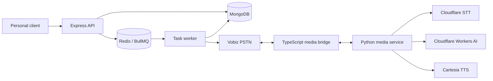
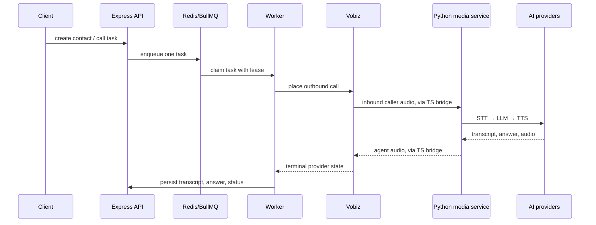
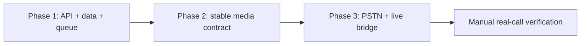
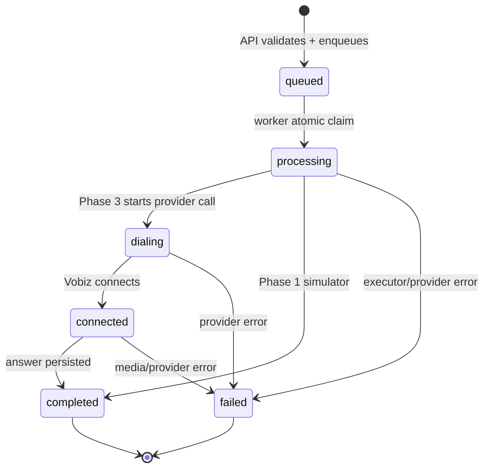

# Call Agent

Call Agent is a personal voice-call system for Aryan. It creates a task for a
known contact, makes one focused outbound call, handles the related
conversation, captures the answer, and records the result.

The project is intentionally built in small vertical phases. TypeScript owns
the control plane; Python will own the real-time media turn. This boundary
keeps queueing and task state separate from transcription, LLM, and speech.

> **Current status:** Phase 1 is merged into `main`. It provides contacts,
> call tasks, Redis queueing, worker lifecycle, and manual smoke paths. Phases
> 2 and 3 are the media and live-call roadmap built on top of that foundation.

## Goal

Given a contact and one focused question, the agent should:

1. Call the contact through a telephony provider.
2. Introduce itself, ask the question, and use only relevant context.
3. Preserve conversation context during the call.
4. Confirm that explicit completion criteria are met.
5. Thank the contact, end the call, and persist the result for Aryan.

The first milestone excludes voicemail, retries, callbacks, recordings,
dashboards, analytics, and Circuit integration.

## Architecture



The API, database, queue, and worker are Phase 1. The Vobiz, media bridge, and
Python service are the Phase 2–3 target architecture.

## Agent orchestration



Conversation rules:

- The agent receives relationship, situation context, question, personality,
  greeting, and completion criteria.
- Greeting and original question happen once. Later turns use the caller's
  latest transcript plus in-call history.
- Completion is allowed only after explicit caller evidence meets the task's
  completion criteria.
- MongoDB is the source of truth; Redis only delivers and coordinates work.

### Runtime ownership map

The voice agent is not one process. It is a small orchestration of components,
each with a deliberately narrow job:

| Component | Owns | Must not own |
| --- | --- | --- |
| Express API | Input validation, API-key access, initial persistence, idempotency | Provider media, LLM prompts, queue execution |
| Redis/BullMQ | Delivering a task to a worker | Durable task truth or call outcome |
| TypeScript worker | Claiming work, starting the call, terminal lifecycle persistence | STT, TTS, conversation generation |
| Vobiz | PSTN connection, call events, WebSocket media transport | Agent reasoning, task state |
| TypeScript media bridge | Vobiz event handling, turn boundaries, μ-law/PCM conversion, audio playback checkpoints | Business rules or LLM decisions |
| Python media service | One conversation turn and the provider calls inside it | MongoDB, Redis, Vobiz REST calls, notifications |
| Cloudflare STT | Caller audio → text | Conversation state or completion |
| Cloudflare LLM | Natural answer + explicit completion decision | Telephony control or persistence |
| Cartesia | Text → spoken audio | Conversation decisions |
| MongoDB | Final contact/task/transcript/result record | Queue delivery |

The critical Phase 2–3 turn loop is:

```text
1. Vobiz emits inbound μ-law audio.
2. TS bridge buffers one caller turn and converts it to WAV.
3. Python service transcribes it, builds prompt context, asks the LLM, then synthesizes speech.
4. Python returns transcript + answer + intentComplete + WAV audio.
5. TS persists the conversation history and streams returned audio to Vobiz.
6. If intentComplete is false, the next caller turn starts at step 1.
7. If intentComplete is true, TS waits for Vobiz to confirm final audio playback,
   hangs up using the stored provider call ID, then persists completion.
```

This division prevents a hallucinated model response, public WebSocket payload,
or queue retry from directly choosing a call to end or changing durable task
state.

### Development orchestration

Work is deliberately split by dependency, not by arbitrary service ownership:



The contract between phases is written down before the next phase starts. That
lets the API/worker and media components evolve independently while preserving
one small request/response boundary.

## Tech stack and providers

| Area | Technology | Responsibility |
| --- | --- | --- |
| API/control plane | Node.js 22, TypeScript, Express 5 | APIs, task state, auth, webhooks |
| Database | MongoDB | Contacts, tasks, transcripts, provider outcomes |
| Queue | Redis + BullMQ | Delivery and single-worker task claims |
| Media plane | Python, FastAPI | One audio turn: transcription → response → speech |
| Telephony | Vobiz | Outbound PSTN calls and bidirectional media |
| STT | Cloudflare Grok STT | Caller audio → transcript |
| LLM | Cloudflare Workers AI | Conversation response and completion decision |
| TTS | Cartesia | Agent response → WAV audio |
| CI | GitHub Actions | Formatting, linting, type checks, build/compile |

## Repository structure

```text
call-agent/
├── backend/                         # Phase 1 TypeScript control plane
│   ├── src/
│   │   ├── app.ts                   # Express app and health routes
│   │   ├── server.ts                # HTTP server and graceful shutdown
│   │   ├── middleware/              # Personal API-key auth
│   │   ├── models/                  # MongoDB indexes and collections
│   │   ├── platform/                # MongoDB, Redis, queue, readiness
│   │   ├── routes/
│   │   │   ├── root.ts              # /v1/api mount
│   │   │   ├── contacts/            # Contact routes
│   │   │   └── call-tasks/          # Call-task routes
│   │   ├── services/                # Business logic
│   │   ├── types/                   # Explicit TypeScript contracts
│   │   ├── utils/env.ts             # Validated environment access
│   │   └── workers/                 # BullMQ task worker
│   └── package.json
├── bolna-service/                   # Phase 2 Python media plane (roadmap)
│   ├── main.py                      # POST /v1/sessions
│   ├── orchestrator.py              # STT → LLM → TTS turn orchestration
│   └── providers/                   # Cloudflare and Cartesia adapters
├── .github/workflows/               # Pull-request CI
├── docker-compose.yml               # Local MongoDB, Redis, backend
├── .env.example                     # Safe environment template
└── plans/voice-call-agent-phase-1-3.md
```

## Phase roadmap

| Phase | Outcome | Status |
| --- | --- | --- |
| 1. TypeScript backend | Contacts, protected APIs, MongoDB, Redis/BullMQ, idempotent task queueing, worker lifecycle | Merged into `main` |
| 2. Media service | Stable TypeScript ↔ Python contract and provider-neutral STT → LLM → TTS turn | Planned / developed above Phase 1 |
| 3. Vobiz integration | Outbound call, media bridge, conversation turns, final playback checkpoint, call hang-up | Planned / developed above Phase 2 |

Phase 1 was delivered in dependency order:

1. Express + TypeScript + pnpm initialization and CI.
2. Environment validation, API-key auth, MongoDB, Redis, and BullMQ.
3. Contact storage and API.
4. Idempotent call-task creation and queueing.
5. Atomic worker claims and lifecycle persistence.

The [delivery plan](plans/voice-call-agent-phase-1-3.md) is the detailed
source of truth for scope, provider contracts, and manual E2E cases.

### What each phase owns

**Phase 1 — control plane** owns durable data and safe delivery. The API
validates input, MongoDB stores contacts and task state, BullMQ delivers work,
and the worker atomically claims each task. The current worker uses a
deterministic simulator so the lifecycle can be manually verified without
placing a real phone call.

**Phase 2 — media plane** owns exactly one provider-neutral conversation turn:
audio in → transcript → LLM answer → generated WAV audio. It does not own
MongoDB, Redis, Vobiz call creation, or task status.

**Phase 3 — telephony and live turns** owns Vobiz callbacks, the bidirectional
media socket, μ-law/PCM conversion, turn boundaries, final-audio playback
confirmation, and authenticated call hang-up. TypeScript remains the owner of
the final task outcome.

## Data model and lifecycle

### Contact

Contacts are the approved people an agent may call. Phone numbers must be E.164
and are unique.

```json
{
  "name": "Shreya",
  "phoneNumber": "+919049122622",
  "relation": {
    "relationship": "friend",
    "closeness": "close"
  }
}
```

`relationship` is one of `mother`, `father`, `sibling`, `friend`, `colleague`,
or `other`. `closeness` is one of `inner_circle`, `close`, `familiar`, or
`formal`.

### Call task

A call task is an immutable request snapshot plus its execution state. The
relation snapshot is stored with the task so an active or historical call
retains the context it was created with, even if the contact changes later.

```json
{
  "contactId": "<MongoDB contact id>",
  "relation": {
    "relationship": "friend",
    "description": "Aryan's close friend",
    "closeness": "close"
  },
  "question": "Can you bring a cake?",
  "context": "There is a small birthday celebration.",
  "personality": "Warm, brief, respectful and conversational.",
  "isFirstCall": true
}
```

The task document stores the idempotency key, task request, timestamps,
processing lease, status, provider identifiers, transcript, confirmed answer,
duration, notification state, and private provider failure detail.

### Task state machine



`claimToken` and the five-minute worker lease prevent an old worker from
writing a task after another worker has claimed it. A terminal task has no
active `processing` value and is never initiated again.

### Reliability rules

- `contacts.phoneNumber` is unique.
- `call_tasks.idempotencyKey` is unique.
- The same `Idempotency-Key` returns the original task and never enqueues a
  second job.
- The API checks that the referenced contact exists before creating a task.
- A worker must atomically claim a queued task before it can modify it.
- MongoDB is authoritative for task state; Redis is not a source of historical
  truth.
- Provider errors are persisted privately with a clear public task failure.

## API examples

Export the local API key only for the current shell:

```sh
export PERSONAL_API_KEY='replace-with-your-local-key'
```

Create a contact:

```sh
curl -i -X POST http://localhost:3000/v1/api/contacts \
  -H "x-api-key: $PERSONAL_API_KEY" \
  -H 'content-type: application/json' \
  --data-binary '{
    "name": "Shreya",
    "phoneNumber": "+919049122622",
    "relation": { "relationship": "friend", "closeness": "close" }
  }'
```

Create a call task. Replace `<contactId>` with the created contact's `id` and
use a new idempotency key for each genuinely new task:

```sh
curl -i -X POST http://localhost:3000/v1/api/call-tasks \
  -H "x-api-key: $PERSONAL_API_KEY" \
  -H 'Idempotency-Key: local-smoke-001' \
  -H 'content-type: application/json' \
  --data-binary '{
    "contactId": "<contactId>",
    "relation": {
      "relationship": "friend",
      "description": "Close friend of Aryan",
      "closeness": "close"
    },
    "question": "Can you bring a cake?",
    "context": "There is a small birthday celebration.",
    "personality": "Warm, brief and respectful.",
    "isFirstCall": true
  }'
```

The first request returns `202 { "message": "Call task queued", "task": ... }`.
Repeating the same request with the same header returns `200` and the original
task with `"message": "Call task already queued"`.

Read a task:

```sh
curl -i http://localhost:3000/v1/api/call-tasks/<taskId> \
  -H "x-api-key: $PERSONAL_API_KEY"
```

For the current Phase 1 simulator, submit `"question":"__simulate_failure__"`
to verify the failed-task path. This marker is temporary and must disappear
when real calling replaces the simulator.

## API overview

All `/v1/api/*` routes require `x-api-key: $PERSONAL_API_KEY`.

| Method | Route | Purpose |
| --- | --- | --- |
| `GET` | `/health` | Liveness check; no dependency access |
| `GET` | `/ready` | MongoDB and Redis readiness |
| `POST` | `/v1/api/contacts` | Create a contact |
| `GET` | `/v1/api/contacts` | List contacts |
| `GET` | `/v1/api/contacts/:contactId` | Read one contact |
| `POST` | `/v1/api/call-tasks` | Create or retrieve an idempotent task |
| `GET` | `/v1/api/call-tasks/:taskId` | Read task status and result |

Creating a call task requires `Idempotency-Key`. Reusing it returns the
existing task instead of queueing a second task or call.

## Local setup

### Prerequisites

- Node.js 22+
- pnpm 12+
- MongoDB and Redis, locally or through Docker Compose
- A non-default personal API key

### Start the Phase 1 backend

```sh
git clone https://github.com/aryanc381/call-agent.git
cd call-agent
cp .env.example .env
# Edit .env and set PERSONAL_API_KEY.
pnpm install
pnpm dev
```

The API listens on `http://localhost:3000` by default:

```sh
curl http://localhost:3000/health
curl http://localhost:3000/ready
```

### Start MongoDB and Redis with Docker

```sh
docker compose up --build
```

For persistent BullMQ deployments, set Redis to the `noeviction` max-memory
policy so queued jobs cannot disappear under memory pressure.

### Local topology

For Phase 1, there are two supported local arrangements:

```text
Option A: all containers
Docker Compose → backend + MongoDB + Redis

Option B: local backend
pnpm dev → backend
docker compose up mongodb redis → dependencies
```

Use Option B while editing TypeScript because `tsx watch` restarts the backend
on source changes. Do not run a second backend on port `3000` at the same time.

When Phase 3 is enabled locally, three long-running processes are required:

```text
Terminal 1: docker compose up mongodb redis
Terminal 2: pnpm dev                         # TypeScript API + worker + media bridge
Terminal 3: Python uvicorn on port 8000       # media service
```

Vobiz needs public HTTPS and WebSocket endpoints for its answer callback and
media stream. In local development, expose the TypeScript and Python ports with
separate tunnels and put their current public URLs in `PUBLIC_BASE_URL` and
`MEDIA_SERVICE_BASE_URL`. Tunnel URLs are temporary: update the environment and
restart the affected service whenever the tunnel changes.

### Useful commands

```sh
pnpm dev
pnpm lint
pnpm typecheck
pnpm build
pnpm format
```

### Future media-service setup

Once Phase 2 is present on your checked-out branch:

```sh
python3 -m venv bolna-service/.venv
source bolna-service/.venv/bin/activate
python3 -m pip install -r bolna-service/requirements.txt
python3 -m uvicorn main:app --app-dir bolna-service --host 0.0.0.0 --port 8000
```

The media service reads the root `.env` and must be running before Phase 3 can
use `MEDIA_SERVICE_BASE_URL`.

### Manual smoke sequence

1. Start MongoDB and Redis, then start the backend.
2. Check `GET /health`; it should return `{"status":"ok"}`.
3. Check `GET /ready`; it should return readiness only after MongoDB and Redis
   connect.
4. Create a contact, then create a task with a unique `Idempotency-Key`.
5. Repeat the task request with the same key and verify no second task appears.
6. Fetch the task until the Phase 1 worker records `completed` or `failed`.
7. For live-call phases, watch both TypeScript and Python logs during a real
   call, then fetch the task for its final transcript and provider outcome.

## Environment variables

`.env` is ignored by Git. Start with `.env.example`; never commit real keys,
phone numbers, credentials, or tunnel URLs.

| Variable | Needed in phase | Purpose |
| --- | --- | --- |
| `PORT` | 1 | Express port |
| `MONGODB_URI` | 1 | MongoDB connection |
| `REDIS_URL` | 1 | Redis/BullMQ connection |
| `PERSONAL_API_KEY` | 1 | Personal API authentication |
| `VOBIZ_AUTH_ID`, `VOBIZ_AUTH_TOKEN` | 3 | Vobiz API authentication |
| `VOBIZ_FROM_NUMBER`, `VOBIZ_BASE_URL` | 3 | Outbound-call configuration |
| `PUBLIC_BASE_URL` | 3 | Public webhook/media base URL |
| `MEDIA_SERVICE_BASE_URL` | 3 | Python media-service URL |
| `CLOUDFLARE_ACCOUNT_ID`, `CLOUDFLARE_API_TOKEN` | 2 | Cloudflare authentication |
| `CLOUDFLARE_STT_MODEL`, `CLOUDFLARE_AI_MODEL` | 2 | STT and LLM selection |
| `CARTESIA_API_KEY`, `CARTESIA_MODEL_ID`, `CARTESIA_VOICE_ID` | 2 | Voice synthesis |
| `BOLNA_*` | 2–3 | Reserved/documented Bolna settings |

### Provider configuration checklist

**MongoDB and Redis** are required before the backend becomes ready. Use a
MongoDB URI with a database name and a Redis endpoint reachable by both the API
and worker. BullMQ requires Redis `noeviction` in durable environments.

**Cloudflare Workers AI** needs an account ID, API token, LLM model ID, and STT
model ID. The implementation must use current Cloudflare documentation for the
account-scoped endpoint and exact audio request format. A JSON-mode-supported
LLM is needed when a strict structured completion decision is required.

**Cartesia** needs an API key, model ID, and voice ID. The generated audio is
returned as WAV from the Python media service and converted at the Vobiz bridge
boundary when the provider requires μ-law audio.

**Vobiz** needs its authentication identifiers, a verified outbound number,
and public callback URLs. Configure the answer callback from `PUBLIC_BASE_URL`;
the answer endpoint returns VobizXML that opens the bidirectional stream. Do
not reuse a stale tunnel URL.

**Bolna** variables are reserved for documented Bolna API/session integration.
The local Python media service is purposefully narrow and does not use Bolna to
own task state, queues, MongoDB, or telephony.

## Engineering guardrails

- Keep code simple, lean, reusable, and focused on the current requirement.
- Reuse existing types, helpers, services, and provider adapters before adding
  abstractions.
- Routes call services directly; business logic does not live in route files.
- Feature route files belong under named `routes/` subfolders; `root.ts` mounts
  shared/versioned routes.
- Every function gets a one-line purpose comment. Every route gets a multiline
  usage/request/response comment.
- Read current official provider documentation before integrating a provider;
  never guess authentication, endpoints, media formats, or webhook contracts.
- Keep environment access in `utils/env.ts` and auth in
  `middleware/auth.middleware.ts`.
- Do not add automated test files. Use formatting, linting, type checks, builds,
  and documented manual smoke paths instead.
- Treat callback data as untrusted; verify provider signatures before changing
  task state.
- Never commit secrets; use environment variables and deployment secrets.

## Quality checks and smoke testing

PRs targeting `main` run GitHub Actions checks for TypeScript and Python. The
TypeScript job installs from the lockfile and runs formatting, linting, type
checks, and a production build. The Python job installs requirements and
compiles the service.

The Phase 1 manual smoke path covers health/readiness, API-key rejection,
valid/invalid/duplicate contacts, idempotent call-task creation,
missing-contact rejection, and queued/completed/failed worker states.

## Integration blockers encountered

The following are real integration lessons from building the Phase 2–3 path.
They are documented here so a future local setup does not mistake a provider,
tunnel, or audio-format issue for an application bug.

| Blocker | What happened | Resolution / operating rule |
| --- | --- | --- |
| Redis client closed during readiness | A lazy Redis connection was pinged before it had connected, producing `Connection is closed`. | Explicitly connect a `wait`-state client before readiness/queue work. `/ready` reports unavailable until both dependencies are usable. |
| Redis eviction warning | Managed Redis advertised `volatile-lru`; BullMQ warns because queued jobs can be evicted. | Use `noeviction` for any durable queue deployment. This is a deployment requirement, not a cosmetic warning. |
| Cloudflare STT returned `402` | Funding the wrong Cloudflare product or using a Gateway without usable balance produced `Insufficient balance`. | Confirm Workers AI/Gateway billing, account, token, and model access before debugging application code. |
| Cloudflare STT response shape differed | The first adapter assumed `result.text`; the actual response could contain a nested `result.result.text` envelope. | Validate response shape, log safe metadata, and fail the turn with a clear provider error rather than a Python `KeyError`. |
| Public tunnel returned `502` | Vobiz reached a temporary tunnel whose local Python process was stopped, unreachable, or pointed at the wrong port. | Check local `/health` first, then the public tunnel `/health`; restart the tunnel and update the exact environment URL when it changes. |
| Muffled/deep generated voice | Vobiz expects 8 kHz μ-law media while TTS produces WAV. Sending mismatched audio characteristics makes speech sound distorted. | Keep WAV inside the Python media contract and convert at the TypeScript Vobiz boundary to the documented μ-law/8 kHz format. |
| Agent audio entered the next turn | Playback and inbound media can overlap, causing the agent's own output to be treated as caller input. | Consume only documented inbound-track media, clear playback on caller barge-in, and keep turn/playback state separate. |
| Quiet caller speech was missed | A fixed, high energy threshold dropped early or quiet syllables before STT. | Use a conservative turn detector with a short audio lead-in, and inspect STT transcript logs before changing the prompt. |
| LLM emitted control text or malformed JSON | A model can ignore a requested structured shape and emit text such as a completion field without a natural answer. | Treat completion as false unless there is a valid explicit boolean decision. Never allow raw provider/model control text to directly hang up a call. Use documented JSON mode only with a model that supports it. |
| Agent repeated the original question | Supplying the task question on every turn gave the LLM a strong reason to ask it again despite history. | Supply greeting + original question only on the first turn. Follow-up prompts use turn instruction, latest transcript, and history. |
| Task submitted twice | Replaying a client request could otherwise make duplicate outbound calls. | Require `Idempotency-Key`, persist it uniquely, and return the existing task for repeat submissions. |

### Debugging order for a live call

When a live call does not behave correctly, diagnose in this order:

1. **Backend readiness:** `GET /health`, then `GET /ready`.
2. **Public reachability:** check the public TypeScript and Python tunnel health
   URLs from outside localhost.
3. **Vobiz control plane:** confirm outbound-call request, answer callback, and
   media WebSocket connection appeared in TypeScript logs.
4. **Inbound audio:** confirm frames and a caller turn were detected; do not
   change an LLM prompt before knowing whether STT received audio.
5. **STT:** inspect transcript length and safe provider error metadata.
6. **LLM:** verify it returned a natural answer and an explicit completion
   decision; do not let unstructured text control hang-up.
7. **TTS/audio bridge:** confirm WAV generation and μ-law playback conversion.
8. **Terminal state:** fetch the call task and inspect its public failure reason
   and privately retained provider error.

Never paste API tokens, database passwords, or webhook secrets into issue
comments, PRs, logs intended for sharing, or this README.

## Provider references

- [Vobiz Python voice-call example](https://github.com/vobiz-ai/Vobiz-Python-Voice-API-Example)
- [Vobiz streaming integration](https://www.vobiz.ai/integrations/pipecat/)
- [Cloudflare Workers AI OpenAI compatibility](https://developers.cloudflare.com/workers-ai/configuration/open-ai-compatibility/)
- [Cloudflare Grok STT model](https://developers.cloudflare.com/ai/models/xai/grok-stt/)
- [Cartesia Python SDK](https://github.com/cartesia-ai/cartesia-python)
- [Bolna API documentation](https://www.bolna.ai/docs/api-reference/introduction)
