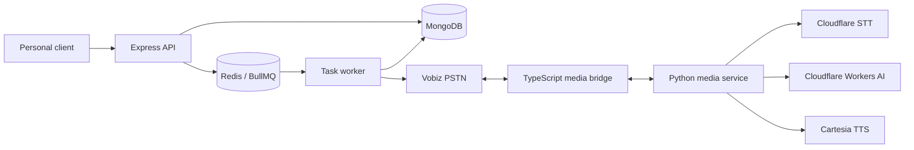
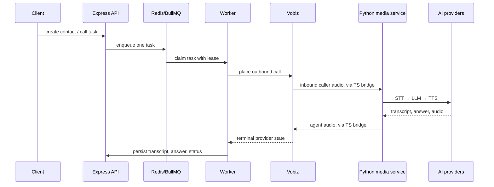

# Call Agent

Call Agent is a personal voice-call system for Aryan. It creates a task for a
known contact, makes one focused outbound call, handles the related
conversation, captures the answer, and records the result.

The project is intentionally built in small vertical phases. TypeScript owns
the control plane; Python will own the real-time media turn. This boundary
keeps queueing and task state separate from transcription, LLM, and speech.

> **Current status:** Phase 1 is merged into `main`. It provides contacts,
> call tasks, Redis queueing, worker lifecycle, and manual smoke paths. Phases
> 2 and 3 are the media and live-call roadmap built on top of that foundation.

## Goal

Given a contact and one focused question, the agent should:

1. Call the contact through a telephony provider.
2. Introduce itself, ask the question, and use only relevant context.
3. Preserve conversation context during the call.
4. Confirm that explicit completion criteria are met.
5. Thank the contact, end the call, and persist the result for Aryan.

The first milestone excludes voicemail, retries, callbacks, recordings,
dashboards, analytics, and Circuit integration.

## Architecture



The API, database, queue, and worker are Phase 1. The Vobiz, media bridge, and
Python service are the Phase 2–3 target architecture.

## Agent orchestration



Conversation rules:

- The agent receives relationship, situation context, question, personality,
  greeting, and completion criteria.
- Greeting and original question happen once. Later turns use the caller's
  latest transcript plus in-call history.
- Completion is allowed only after explicit caller evidence meets the task's
  completion criteria.
- MongoDB is the source of truth; Redis only delivers and coordinates work.

## Tech stack and providers

| Area | Technology | Responsibility |
| --- | --- | --- |
| API/control plane | Node.js 22, TypeScript, Express 5 | APIs, task state, auth, webhooks |
| Database | MongoDB | Contacts, tasks, transcripts, provider outcomes |
| Queue | Redis + BullMQ | Delivery and single-worker task claims |
| Media plane | Python, FastAPI | One audio turn: transcription → response → speech |
| Telephony | Vobiz | Outbound PSTN calls and bidirectional media |
| STT | Cloudflare Grok STT | Caller audio → transcript |
| LLM | Cloudflare Workers AI | Conversation response and completion decision |
| TTS | Cartesia | Agent response → WAV audio |
| CI | GitHub Actions | Formatting, linting, type checks, build/compile |

## Repository structure

```text
call-agent/
├── backend/                         # Phase 1 TypeScript control plane
│   ├── src/
│   │   ├── app.ts                   # Express app and health routes
│   │   ├── server.ts                # HTTP server and graceful shutdown
│   │   ├── middleware/              # Personal API-key auth
│   │   ├── models/                  # MongoDB indexes and collections
│   │   ├── platform/                # MongoDB, Redis, queue, readiness
│   │   ├── routes/
│   │   │   ├── root.ts              # /v1/api mount
│   │   │   ├── contacts/            # Contact routes
│   │   │   └── call-tasks/          # Call-task routes
│   │   ├── services/                # Business logic
│   │   ├── types/                   # Explicit TypeScript contracts
│   │   ├── utils/env.ts             # Validated environment access
│   │   └── workers/                 # BullMQ task worker
│   └── package.json
├── bolna-service/                   # Phase 2 Python media plane (roadmap)
│   ├── main.py                      # POST /v1/sessions
│   ├── orchestrator.py              # STT → LLM → TTS turn orchestration
│   └── providers/                   # Cloudflare and Cartesia adapters
├── .github/workflows/               # Pull-request CI
├── docker-compose.yml               # Local MongoDB, Redis, backend
├── .env.example                     # Safe environment template
└── plans/voice-call-agent-phase-1-3.md
```

## Phase roadmap

| Phase | Outcome | Status |
| --- | --- | --- |
| 1. TypeScript backend | Contacts, protected APIs, MongoDB, Redis/BullMQ, idempotent task queueing, worker lifecycle | Merged into `main` |
| 2. Media service | Stable TypeScript ↔ Python contract and provider-neutral STT → LLM → TTS turn | Planned / developed above Phase 1 |
| 3. Vobiz integration | Outbound call, media bridge, conversation turns, final playback checkpoint, call hang-up | Planned / developed above Phase 2 |

Phase 1 was delivered in dependency order:

1. Express + TypeScript + pnpm initialization and CI.
2. Environment validation, API-key auth, MongoDB, Redis, and BullMQ.
3. Contact storage and API.
4. Idempotent call-task creation and queueing.
5. Atomic worker claims and lifecycle persistence.

The [delivery plan](plans/voice-call-agent-phase-1-3.md) is the detailed
source of truth for scope, provider contracts, and manual E2E cases.

## API overview

All `/v1/api/*` routes require `x-api-key: $PERSONAL_API_KEY`.

| Method | Route | Purpose |
| --- | --- | --- |
| `GET` | `/health` | Liveness check; no dependency access |
| `GET` | `/ready` | MongoDB and Redis readiness |
| `POST` | `/v1/api/contacts` | Create a contact |
| `GET` | `/v1/api/contacts` | List contacts |
| `GET` | `/v1/api/contacts/:contactId` | Read one contact |
| `POST` | `/v1/api/call-tasks` | Create or retrieve an idempotent task |
| `GET` | `/v1/api/call-tasks/:taskId` | Read task status and result |

Creating a call task requires `Idempotency-Key`. Reusing it returns the
existing task instead of queueing a second task or call.

## Local setup

### Prerequisites

- Node.js 22+
- pnpm 12+
- MongoDB and Redis, locally or through Docker Compose
- A non-default personal API key

### Start the Phase 1 backend

```sh
git clone https://github.com/aryanc381/call-agent.git
cd call-agent
cp .env.example .env
# Edit .env and set PERSONAL_API_KEY.
pnpm install
pnpm dev
```

The API listens on `http://localhost:3000` by default:

```sh
curl http://localhost:3000/health
curl http://localhost:3000/ready
```

### Start MongoDB and Redis with Docker

```sh
docker compose up --build
```

For persistent BullMQ deployments, set Redis to the `noeviction` max-memory
policy so queued jobs cannot disappear under memory pressure.

### Useful commands

```sh
pnpm dev
pnpm lint
pnpm typecheck
pnpm build
pnpm format
```

### Future media-service setup

Once Phase 2 is present on your checked-out branch:

```sh
python3 -m venv bolna-service/.venv
source bolna-service/.venv/bin/activate
python3 -m pip install -r bolna-service/requirements.txt
python3 -m uvicorn main:app --app-dir bolna-service --host 0.0.0.0 --port 8000
```

The media service reads the root `.env` and must be running before Phase 3 can
use `MEDIA_SERVICE_BASE_URL`.

## Environment variables

`.env` is ignored by Git. Start with `.env.example`; never commit real keys,
phone numbers, credentials, or tunnel URLs.

| Variable | Needed in phase | Purpose |
| --- | --- | --- |
| `PORT` | 1 | Express port |
| `MONGODB_URI` | 1 | MongoDB connection |
| `REDIS_URL` | 1 | Redis/BullMQ connection |
| `PERSONAL_API_KEY` | 1 | Personal API authentication |
| `VOBIZ_AUTH_ID`, `VOBIZ_AUTH_TOKEN` | 3 | Vobiz API authentication |
| `VOBIZ_FROM_NUMBER`, `VOBIZ_BASE_URL` | 3 | Outbound-call configuration |
| `PUBLIC_BASE_URL` | 3 | Public webhook/media base URL |
| `MEDIA_SERVICE_BASE_URL` | 3 | Python media-service URL |
| `CLOUDFLARE_ACCOUNT_ID`, `CLOUDFLARE_API_TOKEN` | 2 | Cloudflare authentication |
| `CLOUDFLARE_STT_MODEL`, `CLOUDFLARE_AI_MODEL` | 2 | STT and LLM selection |
| `CARTESIA_API_KEY`, `CARTESIA_MODEL_ID`, `CARTESIA_VOICE_ID` | 2 | Voice synthesis |
| `BOLNA_*` | 2–3 | Reserved/documented Bolna settings |

## Engineering guardrails

- Keep code simple, lean, reusable, and focused on the current requirement.
- Reuse existing types, helpers, services, and provider adapters before adding
  abstractions.
- Routes call services directly; business logic does not live in route files.
- Feature route files belong under named `routes/` subfolders; `root.ts` mounts
  shared/versioned routes.
- Every function gets a one-line purpose comment. Every route gets a multiline
  usage/request/response comment.
- Read current official provider documentation before integrating a provider;
  never guess authentication, endpoints, media formats, or webhook contracts.
- Keep environment access in `utils/env.ts` and auth in
  `middleware/auth.middleware.ts`.
- Do not add automated test files. Use formatting, linting, type checks, builds,
  and documented manual smoke paths instead.
- Treat callback data as untrusted; verify provider signatures before changing
  task state.
- Never commit secrets; use environment variables and deployment secrets.

## Quality checks and smoke testing

PRs targeting `main` run GitHub Actions checks for TypeScript and Python. The
TypeScript job installs from the lockfile and runs formatting, linting, type
checks, and a production build. The Python job installs requirements and
compiles the service.

The Phase 1 manual smoke path covers health/readiness, API-key rejection,
valid/invalid/duplicate contacts, idempotent call-task creation,
missing-contact rejection, and queued/completed/failed worker states.

## Provider references

- [Vobiz Python voice-call example](https://github.com/vobiz-ai/Vobiz-Python-Voice-API-Example)
- [Vobiz streaming integration](https://www.vobiz.ai/integrations/pipecat/)
- [Cloudflare Workers AI OpenAI compatibility](https://developers.cloudflare.com/workers-ai/configuration/open-ai-compatibility/)
- [Cloudflare Grok STT model](https://developers.cloudflare.com/ai/models/xai/grok-stt/)
- [Cartesia Python SDK](https://github.com/cartesia-ai/cartesia-python)
- [Bolna API documentation](https://www.bolna.ai/docs/api-reference/introduction)
