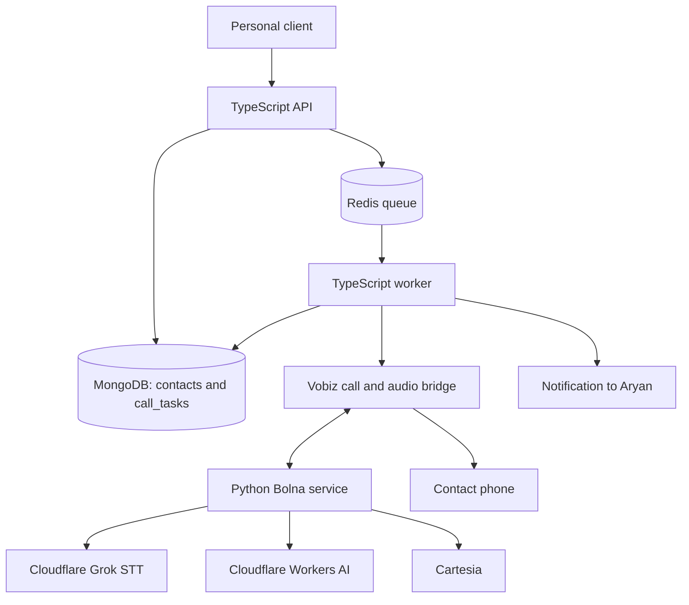
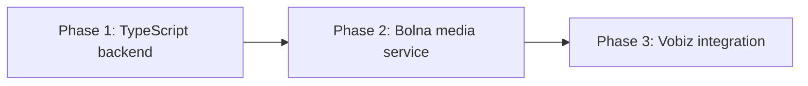

# Voice call agent — phases 1–3

Build a standalone personal voice-call agent that places a one-question call, handles related context, confirms the answer, and notifies Aryan of the result.

Repository: https://github.com/aryanc381/call-agent

## Scope and ownership

`call-agent` is a new standalone repository under `personal/`. Circuit, Circuit UI, and OMS UI are out of scope and receive no changes.

The repository contains two services:

- TypeScript backend: task APIs, MongoDB, Redis queue, Vobiz integration, audio bridge, task state, and notifications.
- Minimal Python Bolna service: live conversation/media orchestration only.

## Functional features

- Create and manage contacts with name, phone number, relation, and closeness.
- Create a call task with a contact, relation, question, context, personality, and first-call flag.
- Queue each task; exactly one worker claims and executes it.
- Initiate and track an outbound Vobiz call.
- Run the live conversation through Bolna, Cloudflare Grok STT, Cloudflare Workers AI, and Cartesia.
- Persist connected/completed/failed state, transcript, confirmed answer, duration, and provider errors.
- Send Aryan a success or failure notification.
- Prevent duplicate calls from duplicate task submissions or worker races.

Excluded: no-answer handling, retries, voicemail, callbacks, recordings, dashboard/metrics UI, and Circuit integration. Dashboard work is deferred to a later plan.

## Models

```text
MongoDB
├── contacts #NEW
│   ├── _id
│   ├── name
│   ├── phoneNumber                         # unique E.164 phone number
│   ├── relation
│   │   ├── relationship                    # mother | father | sibling | friend | colleague | other
│   │   └── closeness                       # inner_circle | close | familiar | formal
│   ├── createdAt
│   └── updatedAt
│
└── call_tasks #NEW
    ├── _id
    ├── idempotencyKey                      # unique
    ├── contactId                           # ObjectId → contacts._id
    ├── request
    │   ├── relation                        # snapshot used by this call's agent input
    │   │   ├── relationship
    │   │   ├── description
    │   │   └── closeness
    │   ├── question
    │   ├── context                         # related background, no FAQ list
    │   ├── personality
    │   └── isFirstCall
    ├── status                              # queued | processing | dialing | connected | completed | failed
    ├── processing                          # null once terminal
    │   ├── workerId
    │   ├── claimToken
    │   ├── claimedAt
    │   └── leaseExpiresAt
    ├── provider
    │   ├── vobizCallId
    │   ├── bolnaCallId
    │   └── startedAt
    ├── result
    │   ├── confirmedAnswer
    │   ├── transcript[]
    │   │   ├── speaker                     # agent | contact
    │   │   ├── text
    │   │   ├── startedAtMs
    │   │   └── endedAtMs
    │   ├── durationSeconds
    │   ├── endedAt
    │   ├── failureReason
    │   └── providerError                   # private debugging detail
    ├── notification
    │   └── status                          # pending | success | failure
    ├── createdAt
    └── updatedAt
```

```text
contacts
├── #WRITE create contacts
├── #READ   find contacts
└── #MODIFY change contact data

call_tasks
├── #WRITE  create a queued task
├── #READ   fetch task status/result
└── #MODIFY atomically claim, track call state, save result, update notification
```

Indexes: `contacts.phoneNumber` unique; `call_tasks.idempotencyKey` unique; `call_tasks.status + createdAt`; `call_tasks.contactId`; sparse unique `call_tasks.provider.vobizCallId`.

## Agent session input

The TypeScript worker combines the task and referenced contact phone number, then sends Bolna:

```json
{
  "contact": {
    "name": "Mom",
    "relation": "mother",
    "relationDescription": "Aryan's mother",
    "closeness": "inner_circle"
  },
  "question": "Can you bring a cake when you come home?",
  "context": "It is Aryan's birthday today and there is a small celebration at home.",
  "personality": "Warm, brief, respectful and conversational.",
  "isFirstCall": true
}
```

The conversation rule is: short first-call intro, ask the primary question, use only related context for follow-ups, confirm the answer, and end the call.

## File tree

```text
call-agent/
├── .github/
│   └── workflows/
│       └── pull-request.yml                       #NEW — TypeScript/Python PR checks
├── backend/                                        #NEW — TypeScript control plane
│   ├── src/
│   │   ├── server.ts                                # HTTP + WebSocket server
│   │   ├── utils/
│   │   │   └── env.ts                               # environment validation
│   │   ├── middleware/
│   │   │   └── auth.middleware.ts                   # personal API-key auth
│   │   ├── routes/
│   │   │   ├── root.ts                              # versioned API route mount
│   │   │   └── contacts/
│   │   │       └── contacts.route.ts                # contact API
│   │   │   └── call-tasks/
│   │   │       └── call-tasks.route.ts               # task API
│   │   ├── webhooks/
│   │   │   └── vobiz.webhook.ts                     # Vobiz status callbacks
│   │   ├── realtime/
│   │   │   └── vobiz-bolna.bridge.ts                # Vobiz audio ↔ Bolna audio
│   │   ├── models/
│   │   │   ├── contact.model.ts                     # contacts collection
│   │   │   └── call-task.model.ts                   # call_tasks collection
│   │   ├── services/
│   │   │   ├── contact.service.ts
│   │   │   ├── call-task.service.ts
│   │   │   ├── vobiz.service.ts                     # Vobiz calls
│   │   │   ├── bolna-client.service.ts              # Bolna session connector
│   │   │   └── notification.service.ts              # result notification
│   │   ├── queue/
│   │   │   └── call-task.queue.ts                   # BullMQ
│   │   ├── workers/
│   │   │   └── call-task.worker.ts                  # task claim/execution
│   │   └── types/
│   │       ├── contact.ts
│   │       ├── call-task.ts
│   │       └── bolna-session.ts                     # TS ↔ Python contract
│   ├── package.json
│   ├── tsconfig.json
│   └── Dockerfile
├── bolna-service/                                  #NEW — minimal Python media plane
│   ├── main.py                                     # session WebSocket/API entrypoint
│   ├── session.py                                  # audio in/out and final result
│   ├── bolna-orchestrator.py                       # Bolna VAD/conversation loop
│   ├── providers/
│   │   ├── stt.py                                 # Cloudflare Grok STT
│   │   ├── llm.py                                 # Cloudflare Workers AI
│   │   └── tts.py                                 # Cartesia
│   ├── config.py                                  # provider configuration
│   ├── requirements.txt
│   └── Dockerfile
├── docker-compose.yml                              #NEW — backend, Bolna, MongoDB, Redis
├── .env.example                                   #NEW — variable names only
├── .gitignore                                     #NEW
└── README.md                                      #NEW — setup and architecture
```

## Routes

| Method | Path | Auth | Request | Success | Failure |
|---|---|---|---|---|---|
| POST | `/v1/api/contacts` | Personal API key | `{ name, phoneNumber, relation: { relationship, closeness } }` | `201 { contact }` | `400`, `409` |
| GET | `/v1/api/contacts` | Personal API key | — | `200 { contacts }` | `401` |
| GET | `/v1/api/contacts/:contactId` | Personal API key | — | `200 { contact }` | `401`, `404` |
| POST | `/v1/api/call-tasks` | Personal API key | `{ contactId, relation, question, context, personality, isFirstCall }` and `Idempotency-Key` | `202 { message, task }`; duplicate key returns `200 { message, task }` | `400`, `401`, `404`, `409` |
| GET | `/v1/api/call-tasks/:taskId` | Personal API key | — | `200 { task }` | `401`, `404` |
| POST | `/webhooks/vobiz` | Vobiz signature | provider-defined signed status payload | `204` | `401`, `404` |

The Vobiz adapter normalizes its provider payload into internal state; no other code depends on Vobiz field names.

## Services and rules

| Owner | Function | Arguments | Return | Side effects |
|---|---|---|---|---|
| Contact service | `createContact`, `listContacts`, `getContact` | contact input / ID | contact(s) | MongoDB read/write |
| Task service | `createCallTask` | task input, idempotency key | queued task | saves task, adds queue job |
| Task service | `claimCallTask` | task ID, worker ID | claimed task / null | atomic lease claim |
| Task service | `updateCallStatus`, `completeCallTask`, `failCallTask` | task ID and state/result | task | lifecycle/result persistence |
| Vobiz service | `createCall` | phone number, stream URL, task ID | provider call ID | outbound call |
| Bolna client | `startSession` | agent session input | session ID | starts media session |
| Media bridge | `bridgeAudio` | Vobiz and Bolna sockets | void | bidirectional audio frames |
| Notification service | `sendTaskResult` | terminal task | delivery status | sends result and updates notification status |

Only the worker can initiate a call. API input is validated before persistence. A duplicate idempotency key returns the existing task and must never enqueue or call twice. A terminal task cannot be initiated again. Vobiz webhook signatures are verified before processing.

## E2E smoke path

```text
[Create contact]
  name + phoneNumber + relation + closeness
        │
        v
POST /v1/api/contacts ────────────────────────► contacts saved in MongoDB

[Create call task]
  contactId + relation + question + context + personality + isFirstCall
        │
        v
POST /call-tasks ─────────────────────────────► call_tasks.status = queued
        │
        v
Redis queue ──────────────────────────────────► TS worker claims task
                                                     │
                                                     v
                                          Read contact phoneNumber
                                                     │
                                                     v
                                          Start Bolna session
                                                     │
                                                     v
                                   Vobiz dials contact phoneNumber
                                                     │
                                                     v
                                           Call connected
                                                     │
                                                     v
                      Intro → question → related context → confirmation
                                                     │
                                                     v
                    completed + transcript + confirmedAnswer persisted
                                                     │
                                                     v
                          notification.success → Aryan gets result

[Invalid API key] ───────────────► 401; no write and no queue job
[Invalid contact/task input] ────► 400; no write and no queue job
[Unknown contactId] ─────────────► 404; no task and no queue job
[Same Idempotency-Key] ──────────► existing task; no second job/call
[Vobiz cannot connect] ──────────► failed + failureReason + notification.failure
```

Human E2E testing is required for the real Vobiz phone call in Phase 3.

## Architecture



## Global engineering rules

**Simple, lean, and reusable code is a non-negotiable requirement for every phase and PR.** Prefer the smallest clear implementation that satisfies the current, documented requirement. Reuse an existing type, helper, service, or provider integration before creating another one.

- Do not add abstractions, layers, wrappers, configuration, or dependencies for hypothetical future needs.
- Keep each module focused on one responsibility and keep public interfaces small and explicit.
- Do not duplicate business rules. Extract shared code only after a real second use makes the shared contract clear.
- Keep PRs as small vertical slices with only the code, validation, and documentation required for that slice.
- Choose readable, direct code over clever or generic code. Any added complexity needs a present requirement and a short justification in the PR.
- Delete dead code and avoid compatibility shims unless an active caller requires them.
- Do not create automated test files. Validate changes with formatting, linting, type checks, builds, and documented manual smoke paths instead.
- Put a one-line comment immediately above every function that states what it does.
- Put a multiline `/** ... */` comment immediately above every route with these three unprefixed lines: `usage: <purpose>`, `req.body: <comma-separated keys or none>`, and `res.body: <response shape>`.
- Place each feature's route files inside a named subfolder under `routes/`; keep only shared route mounts such as `root.ts` directly in `routes/`.
- Keep validated environment access in `utils/env.ts` and authentication middleware in `middleware/auth.middleware.ts`; do not scatter environment reads or auth logic through route handlers.
- Use the traditional route-to-service flow for this project: route handlers call service functions directly. Do not introduce handler maps or Express-aware service factories for Phase 1.
- Before integrating any external provider, read its current official documentation and implement against the documented authentication, endpoint, request, response, webhook, limits, and failure behavior. Record the chosen provider contract in the relevant plan or code comments; do not guess or rely on stale examples.

### Learning note

We are intentionally using the traditional route-to-service pattern because the current priority is learning the voice-agent system, not exploring routing abstractions. We can build a smaller project later to learn handler maps, callback registration, and other route composition patterns without adding that indirection here.

## Delivery phases

### Phase 1 — TypeScript backend

Outcome: MongoDB models, personal API, Redis/BullMQ queue, atomic task claims, lifecycle persistence, and notification state.

Prerequisites: MongoDB and Redis configuration.

Redis must use the `noeviction` max-memory policy because BullMQ cannot safely run when queued jobs may be evicted.

Verification: formatting, linting, type checks, builds, and manual smoke paths cover contact/task creation, validation, duplicate idempotency behavior, and simulated worker success/failure.

#### Dependency-ordered implementation parts

1. **Initialize:** create the `backend/` Express + TypeScript service with pnpm, Docker Compose, environment examples, developer tooling, and the CI skeleton.
2. **Platform foundation:** add configuration validation, Express app/server setup, personal API-key middleware, MongoDB and Redis clients, and BullMQ setup. Depends on part 1.
3. **Contacts:** add contact types, model/indexes, service, routes, and a manual smoke path. Depends on part 2.
4. **Call tasks and queueing:** add task types, model/indexes, idempotency, contact validation, task routes, and BullMQ enqueueing. Depends on part 3.
5. **Worker lifecycle:** add atomic task claims, lifecycle/result persistence, and a simulated completed/failed executor. The manual failure smoke path uses the question marker `__simulate_failure__`; Vobiz, Bolna, and real notification delivery remain deferred. The simulator is temporary and must be removed when real calling is introduced in the Vobiz/Bolna integration phases. Depends on part 4.

#### Phase 1 completion record

Status: **completed and merged into `main`**.

- PR #4 merged the initialization, platform foundation, contacts, call-task API, queueing, and traditional route-to-service structure.
- PR #5 merged the worker lifecycle, atomic claims, simulated execution, result persistence, Redis startup guard, and temporary simulator rule.
- Automated test files were intentionally not added; formatting, linting, type checking, builds, and manual E2E smoke tests were used.

Manual E2E smoke cases completed for the full phase:

- `GET /health` returns `200 { status: "ok" }`.
- `GET /ready` reports dependency readiness and returns unavailable when a required dependency is unavailable.
- Protected routes reject a missing or invalid personal API key with `401`.
- Valid contact creation returns `201`.
- Invalid contact input returns `400`.
- Duplicate contact phone numbers return `409`.
- Contact listing returns `200`.
- Fetching an existing contact returns `200`.
- Fetching a missing contact returns `404`.
- Valid call-task creation returns `202` with `status: "queued"`.
- Reusing a call-task idempotency key returns the existing task ID without creating a second task.
- Invalid call-task input returns `400`.
- An unknown contact ID returns `404` and does not create a task.
- A normal queued task is claimed by the worker and reaches `completed` with a simulated answer and transcript.
- A task using `question: "__simulate_failure__"` reaches `failed` with failure details.
- The backend waits for Redis before accepting task requests, preventing startup queue failures.

#### Pull-request CI

Phase 1 establishes a simple GitHub Actions PR CI workflow in `.github/workflows/pull-request.yml`. It runs on every pull request targeting `main` as one direct `backend` job:

- `actions/checkout@v4`
- `pnpm/action-setup@v4` and `actions/setup-node@v4`
- install with the lockfile, then run formatting, linting, type checking, and a production build

The `backend` check must be a required GitHub branch-protection status check before merging a PR. Phase 2 adds the equally simple Python check once `bolna-service/requirements.txt` exists; do not add placeholder jobs or path-filtering logic before then. Verify the workflow manually by opening a backend-changing PR.

### Phase 2 — Bolna media service

Outcome: a minimal Python service accepts generic audio and agent session input; Bolna conducts the VAD/STT/LLM/TTS loop and returns audio, transcript, and confirmed answer. A local TypeScript audio client tests this without Vobiz.

Prerequisites: locked TypeScript ↔ Python session contract.

Verification: browser microphone or audio file → Bolna → transcript, generated voice, and confirmed answer.

### Phase 3 — Vobiz integration

Outcome: TypeScript initiates Vobiz calls, verifies provider callbacks, bridges live Vobiz audio to Bolna, persists terminal results, and notifies Aryan.

Prerequisites: Phases 1–2 plus Vobiz outbound-call, media-stream, and webhook documentation/credentials.

Verification: human E2E call results in either a completed task and accurate notification or a failed task and failure notification.

## Agent orchestration



One sequential execution wave is required because each phase depends on the preceding phase's contract. No subagents are planned.

## Integration and rollout rules

- Consult official Bolna documentation before any Bolna integration.
- Reuse Bolna's existing OpenAI-compatible provider implementation for Cloudflare Workers AI when the documented interface supports it.
- Do not fork or rewrite Bolna orchestration unless official/documented integration paths cannot support the selected providers.
- Keep Python limited to the Bolna media plane. It must not own MongoDB, Redis, task lifecycle, Vobiz call creation, or notifications.
- Vobiz owns PSTN connectivity; exact media-frame mapping and webhook fields must be verified against its documentation before Phase 3.
- Store provider secrets in deployment secrets/environment variables only; never commit them.
